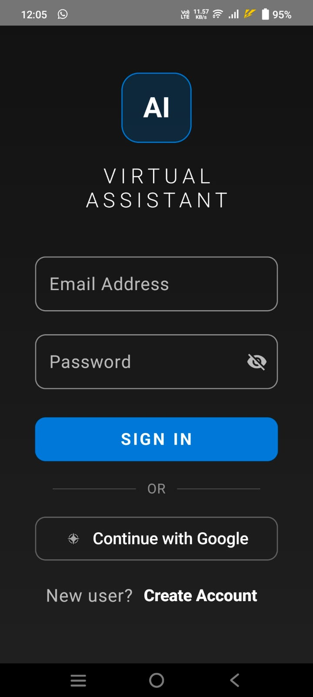
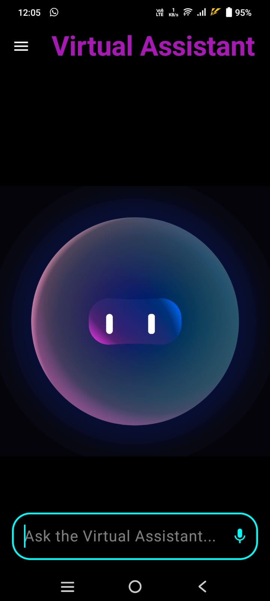
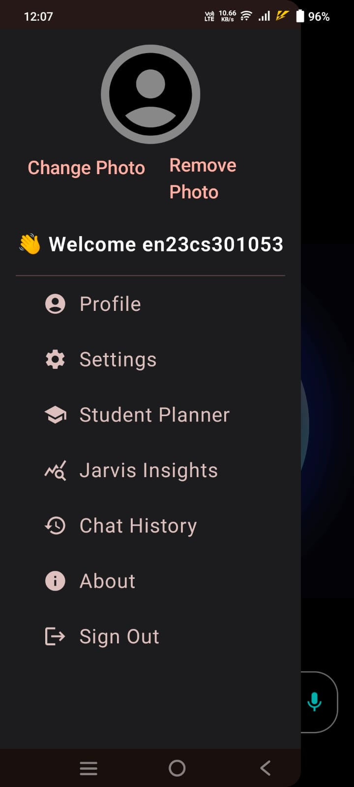
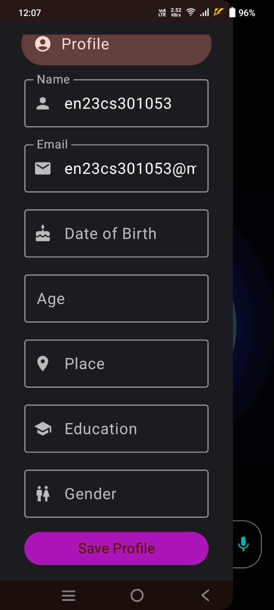
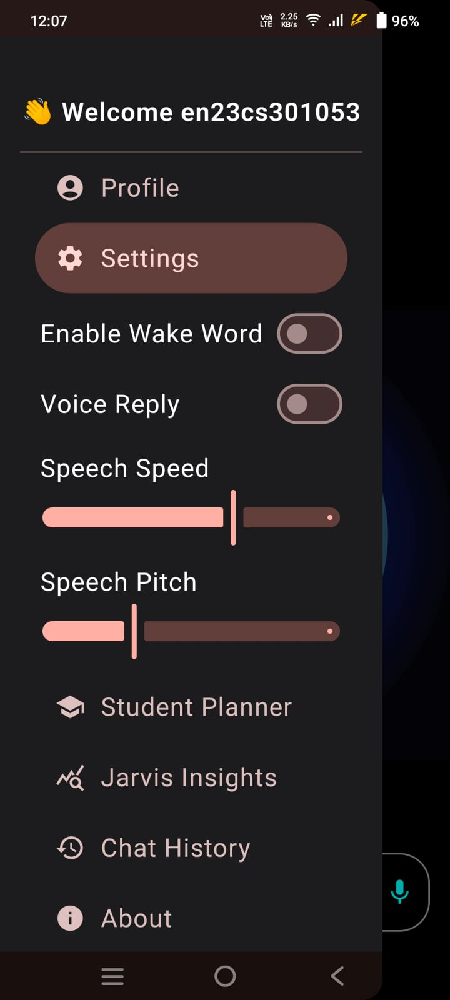
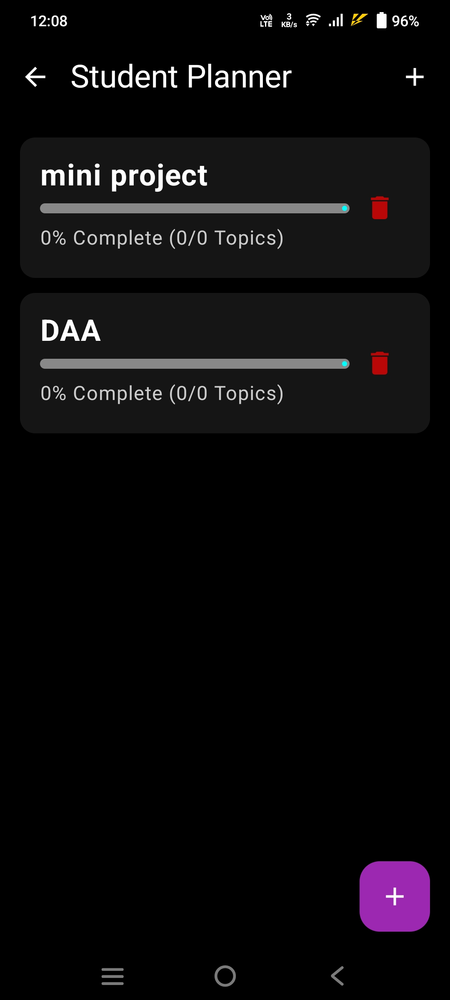
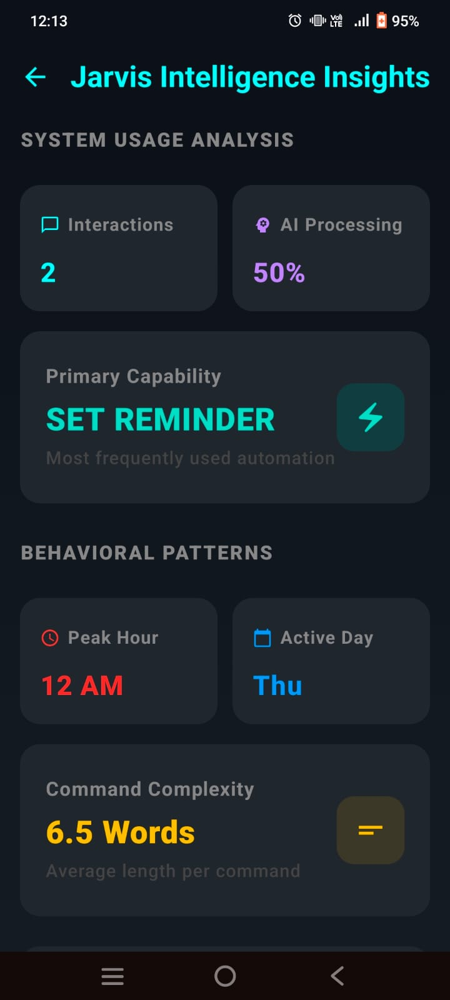
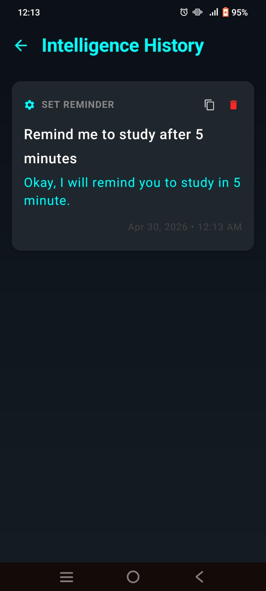

# Virtual Assistant Powered by AI

## Brief Description

Virtual Assistant Powered by AI is an Android-based intelligent assistant developed using Kotlin and Jetpack Compose with FastAPI backend integration. The system supports voice and text commands, wake word detection, reminders, planner management, AI responses, analytics, and personalized user interactions.

## Technology Stack and Tools Used

Frontend:

* Kotlin
* Jetpack Compose
* Android Studio

Backend:

* FastAPI
* Python
* REST APIs

Database:

* Firebase Firestore

Libraries / APIs:

* Speech Recognition API
* Text-to-Speech (TTS)
* Retrofit
* Firebase Authentication

Tools:

* Git
* GitHub
* Postman

## Features and Functionalities

* Voice and Text Commands
* Wake Word Detection
* Reminder Management
* Student Planner
* AI-powered Query Handling
* User Authentication
* Chat History Storage
* Profile Management
* Jarvis Insights Dashboard
* Speech Output using TTS
* Firebase Data Storage

## Installation / Execution Steps

1. Clone Repository

git clone <repository-link>

2. Open Android Studio

3. Sync Gradle Files

4. Configure Firebase

5. Run FastAPI Backend

pip install -r requirements.txt

uvicorn main:app --reload

6. Run Android Application

7. Launch App and Login

## Team Members

* Abhyuday Singh Dixit (EN23CS301053)
* Aayushi Rajput (EN23CS301033)

## Screenshots / Output

## Project Screenshots

### Login Screen

### Main Assistant Interface

### Menu Bar

### Profile Management

### Settings Panel

### Student Planner

### Jarvis Insights Dashboard

### Intelligence History

